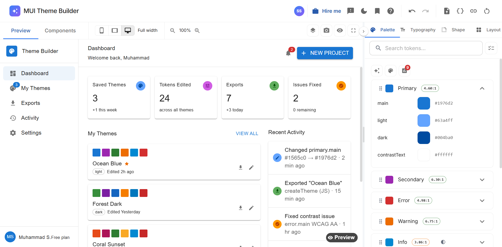

# MUI Theme Builder

A free visual theme editor for [Material UI (MUI)](https://mui.com).  
Customize palette, typography, and shape — preview live, export production-ready code.

**[MUI Theme Builder](https://mui-theme-builder.vercel.app)**

---

## Features

### Palette Editor

- Edit all 6 semantic color roles — primary, secondary, error, warning, info, success
- Control background, text, divider, common colors, and the full grey scale
- HEX, RGBA, and HSLA input modes with a color picker
- Auto-generate light/dark/contrastText from any main color
- Per-color reset buttons, recently used colors
- **Reorderable color roles** — drag any of the 6 semantic color accordions to rearrange them; order is saved to localStorage
- **Generate palette from brand color** — pick a single hex (or use the color picker) to instantly generate all 6 semantic roles using color theory; contrastText is always WCAG-safe
- **Color harmony panel** — derives complementary, analogous, triadic, and split-complementary palettes from your primary color; apply any suggestion with one click
- **WCAG contrast badge** on each semantic color — shows the contrast ratio between `main` and `contrastText`, colored green (AA/AAA pass), amber, or red; includes a one-click fix button to set the highest-contrast text color automatically
- **WCAG accessibility report** — full modal listing every foreground/background pair (semantic colors, their light and dark shades, and text-on-background combinations) scored with AA and AAA chips; per-row fix buttons and a "Fix all" button auto-correct failing pairs without creating circular conflicts
- **Failing-pair badge** on the report icon: shows how many color pairs currently fail AA without opening the report
- **Eyedropper**: pick a color from anywhere on your screen (other tabs, apps, logos) straight from the color picker or the brand color field. Available in Chrome and Edge; hidden in browsers without the EyeDropper API
- **Contrast matrix**: a "Matrix" tab in the WCAG report shows every semantic color and text color against your default and paper backgrounds in one table, with contrast ratios and AA/AAA results
- **Gradient backgrounds** — toggle any background (default or paper) between solid color and gradient; inline editor with angle presets (0°–270°), custom angle input, and independent color pickers for each stop; preview and all Paper/Card/Dialog components reflect the gradient live
- **Saved swatches library** — bookmark icon inside any color picker saves that color to a persistent library (up to 20); saved swatches appear in every picker below "recently used" with hover-to-delete; shared across all color fields and sessions

### Typography

- Pick any Google Font via autocomplete — or type any font name
- Set a separate **heading font** (h1–h6) independent of the body font
- Control base font size and per-variant styles (size, weight, line height, letter spacing)
- Live font preview panel — shows heading and body fonts side by side when both are set
- **Font pairing suggestions** — chips under each font field suggest complementary heading and body fonts; one click applies them
- **System font stack presets** — System UI, Serif, Mono, and Humanist chips apply a font stack with no network request
- **Type scale ruler** — all 13 variants stacked at their real size with your own sample text; click a row to jump to its controls

### Shape & Spacing

- Global border radius with Sharp / Default / Rounded / Pill presets
- Spacing unit slider with Dense / Comfortable / Spacious presets and a spacing scale preview
- **Per-component radius** — Button, Card, Chip, TextField, and Dialog each get their own radius slider
- **Breakpoint editor** — change the xs / sm / md / lg / xl thresholds
- **Shadows** — a global intensity slider, a shadow color picker, presets (Flat, Default, Deep, Colored), and a preview of all 25 elevation levels
- **Motion editor** in the Layout tab: tune the seven transition durations and four easing curves, try them in a live preview, and reset any value; only the values you change are exported
- **Z-index scale** in the Layout tab: edit all eight MUI layers (app bar, drawer, modal, snackbar, tooltip and more), see the stacking order live, and reset any value; only the values you change are exported
- Live shape preview

### Live Preview

- **10 page templates** — switch between Dashboard, Landing, Blog, Auth (sign in/up), Settings, Kanban, Analytics, Inbox, Social feed, and Pricing from the layers icon in the preview toolbar; each template uses your full theme live
- Full e-commerce dashboard driven entirely by your theme
- Device modes — Mobile (390px), Tablet (768px), Desktop (full width)
- **Landscape orientation** — toggle Mobile and Tablet frames between portrait and landscape
- **Zoom, full screen, and screenshot** — zoom the preview from 50% to 125%, open it full screen (`Esc` to exit), or save it as a PNG
- **Collapsible editor panel** — hide the editor to give the preview the full width; the panel width and collapsed state are remembered
- Realistic device frames with dynamic island, status bar, volume buttons
- **Color blindness simulation** — preview your theme as seen with protanopia, deuteranopia, tritanopia, or achromatopsia; toggle from the eye icon in the preview toolbar

### Component Showcase

- 35 interactive MUI component demos — Inputs, Data Display, Feedback, Navigation
- Every demo renders inside your live theme instantly
- Search, pin, and deep-link to any component
- **"Themed" badge** — cards whose appearance actually differs from the MUI defaults are flagged, so you can spot what your edits touched
- **"What uses this?"** — a crosshair icon next to each color role, Typography, Border Radius, and Spacing control jumps straight to the Components tab and highlights every component that token affects
- Component overrides editor coming soon — set default props per component directly from the UI

### Export / Import

- 10+ export formats — JS, TS, JSX, Styled Components, Emotion, CSS Variables,
  Tailwind config, Figma Tokens, and more
- Monaco editor with syntax highlighting
- Copy to clipboard or download as file
- **Code size indicator** — the export toolbar shows the line count and size of the generated code (e.g. "~42 lines · 1.2 KB")
- **Import from JSON**: paste any `createTheme()` config into a live JSON editor with inline syntax highlighting and error/warning detection; partial color overrides (e.g. just `primary.light`) merge with sensible defaults instead of requiring a full color object, missing fields elsewhere fall back automatically so your editor stays fully populated, and extra keys like `components`, `transitions`, and `zIndex` are preserved and passed through all exports unchanged

### Other

- Light / Dark mode toggle
- Undo / Redo — 50-step history (`Ctrl+Z` / `Ctrl+Y`, or buttons in the toolbar)
- **Saved themes** — save up to 20 named themes to localStorage; load, rename, duplicate, or delete them from the bookmark drawer in the toolbar
- **Checkpoints** — save quick snapshots of your current state and restore any of them later (up to 15, newest first); accessible from the Checkpoints tab in the bookmark drawer
- **Change log** — the Changes tab in the bookmark drawer lists every token edited this session with old → new values and color swatches; clears on page refresh
- **Share via URL** — click the link icon in the toolbar to copy a shareable URL that encodes your entire theme; opening the link restores the exact theme instantly
- **Token search** — search bar at the top of the editor panel; type any token name, path, or value (e.g. "primary", "border", "#1976") to instantly filter all ~150 theme tokens across palette, typography, shape, and layout; click a result to jump to that editor tab
- **Tips popover** — the help icon in the toolbar lists quick tips for getting the most out of the builder
- **Token coverage report**: the checklist button next to the token search compares your theme with the MUI defaults and shows how many tokens you have customised, per group (Palette, Typography, Shape, Layout), with each token's default and current value; click a row to jump to it. Breakpoints, shadows and per-component radius are now searchable tokens too
- **Command palette** — `Ctrl+K` opens a searchable palette to jump to any editor section, switch device/preview mode, load a saved theme, or trigger any action
- **Keyboard shortcuts** — press `?` to open the shortcuts panel; highlights include:
  - `D` — toggle dark/light mode
  - `M` / `T` / `W` — switch to Mobile / Tablet / Desktop device view
  - `P` / `C` — switch to Preview / Components tab
  - `F` — toggle full-screen preview (hides the editor panel)
  - `Ctrl+S` — save current theme (saves to active theme if one is set, otherwise opens the bookmark drawer)
  - `Ctrl+E` — open export dialog
  - `Ctrl+Alt+C` — copy theme as JSON directly to the clipboard
  - `Ctrl+Z` / `Ctrl+Y` — undo / redo
  - `/` — focus component search
- Export badge — a dot on the export button signals when your theme has unsaved changes
- Theme persists across sessions (localStorage)
- Fully responsive — works on mobile

---

## Work With Me

This tool is built and maintained by [Saad](https://saadshd.vercel.app/), a freelance React developer. If you need help beyond what the builder can do, I am available for:

- Custom MUI themes and design systems
- React apps and dashboards built on Material UI
- Migrating an existing app to a new or tweaked theme

**How to get in touch**

- Click **Hire me** in the toolbar, then choose **View portfolio** or **Email me**
- Or press `Ctrl+K` and search for "hire"
- Or visit the [portfolio](https://saadshd.vercel.app/) directly

For bugs and feature requests, please use the issue tracker below instead.

---

## Reporting Issues & Feature Requests

Found a bug or have an idea?  
**[Open an issue →](../../issues)**

Please include:

- For bugs: what you did, what you expected, what happened (+ browser/OS)
- For features: what you want and why it would be useful

---

## Roadmap

Active development is ongoing. Follow this repo (Watch → Custom → Issues) to get notified of updates.

**Coming soon:**

- **Custom JSX slot** — paste your own component and preview it live inside `ThemeProvider` with your active theme
- **Component overrides panel** — per-component defaults editor (Button variant, TextField variant, Card elevation, and more) as a dedicated tab in the editor panel
- **Right-click to edit** — right-click any element in the preview to jump directly to the token that controls it

---
